<p align="center">
  
</p>

<p align="center">
  <a href="https://0xblu3guy.github.io/"></a>
  <a href="https://0xblu3guy.github.io/blog/"></a>
  <a href="https://www.linkedin.com/in/sobhan-hosseinpour/"></a>
</p>

Hi, I'm Sobhan. I work in a NOC/operations environment, where my job is making infrastructure visible: metrics, logs, alerts, and the plumbing that connects them. Outside of that, I spend my time on security: taking malware samples apart, reading packet captures, and learning how detection actually works.

Those two halves feed each other. You can't spot abnormal behavior in a system you can't see, and you can't monitor a system well until you understand how it works.

## `/-/config`

```yaml
# sobhan.yml
global:
  scrape_interval: always
  location: Mashhad, Iran

scrape_configs:
  - job_name: day
    role: observability-engineer
    environment: noc / operations
    focus:
      - monitoring architecture for physical servers and VMs
      - alerting workflows that people can act on
      - automating the boring parts with Ansible

  - job_name: always
    role: cybersecurity-enthusiast
    focus:
      - malware analysis
      - network forensics
      - detection and incident investigation

  - job_name: school
    role: student
    field: computer engineering
    target: Islamic Azad University, Mashhad
```

## `/targets`

What I'm doing now, and where I'm heading.

| State | Target | Notes |
| :-- | :-- | :-- |
| 🟢 `UP` | Prometheus-based monitoring | Exporters, service discovery, and inventory-driven targets |
| 🟢 `UP` | Dashboards and alerting | Grafana and Alertmanager workflows |
| 🟢 `UP` | Automation | Ansible for monitoring rollout and firewall configuration |
| 🟢 `UP` | Security labs | Malware analysis and PCAP investigations, written up in public |
| 🔵 `PENDING` | Security operations | SOC work, detection engineering, incident investigation |
| 🔵 `PENDING` | DevSecOps | Where infrastructure and security meet |
| 🔵 `PENDING` | Security research | The longer-term direction |

## `/lab`

Public write-ups from the security side of my learning.

**[rsh-malware-analysis](https://github.com/0xBlu3Guy/rsh-malware-analysis)**
Static and behavioral analysis of a Linux ELF backdoor, with extracted IOCs, MITRE ATT&CK mapping, and YARA rules.

**[smtp-data-exfiltration-pcap-analysis](https://github.com/0xBlu3Guy/smtp-data-exfiltration-pcap-analysis)**
A network forensics scenario: reconstructing cleartext SMTP sessions, credentials, and an attachment from a packet capture using Zeek and Wireshark.

**[blog](https://github.com/0xBlu3Guy/blog)**
The source for [my blog](https://0xblu3guy.github.io/blog/), built with Astro and published to GitHub Pages.

## `/stack`

Tools I work with or am actively exploring. This is my environment, not a list of things I claim to have mastered.

**Observability**


**Infrastructure and automation**


**Security lab**


## `/rules`

The one alert I never silence:

```yaml
groups:
  - name: how-i-work
    rules:
      - alert: ConfigCopiedWithoutUnderstanding
        expr: lines_pasted > 0 and understanding == 0
        for: 0m
        labels:
          severity: page
        annotations:
          summary: "It works, but I don't know why yet."
          runbook: "Read the docs. Break it in a lab. Then deploy it."
```

---

<p align="center">
  <sub>Want to talk monitoring, detection, or a strange spike on a graph? <a href="https://www.linkedin.com/in/sobhan-hosseinpour/">LinkedIn</a> is the best place to reach me.</sub>
</p>
